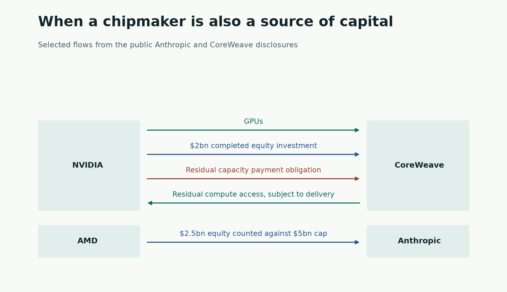

*Part of [The AI Infrastructure Reality Check](/ai-infrastructure-reality-check/).*

Across Microsoft, Alphabet and Meta, operating cash rose by $9.6 billion from the September 2025 quarter to the same quarter in 2026. Cash spent on property and equipment rose by $62.5 billion. I pulled the same cash-flow lines from the three companies' filings. The gap between those increases is where the story is. [Microsoft Form 10-Q](https://www.sec.gov/Archives/edgar/data/789019/000119312526436133/msft-20260930.htm) · [Alphabet results](https://www.sec.gov/Archives/edgar/data/1652044/000165204426000080/googexhibit991q32026.htm) · [Meta results](https://www.sec.gov/Archives/edgar/data/1326801/000162828026066700/meta-09302026xexhibit991.htm)

## The same subtraction across three statements

This comparison uses the three months through September 30 even though Microsoft calls the 2026 period its fiscal first quarter. Cash equipment spend means the purchases or additions to property and equipment shown in investing cash flow, stated here as a positive outflow. The residual is operating cash flow less that outflow. Every number is consolidated and includes the companies' other businesses.

| Company | Operating cash, 2025 → 2026 | Cash property and equipment, 2025 → 2026 | Cash after equipment, 2025 → 2026 |
| --- | ---: | ---: | ---: |
| Microsoft | $45.06bn → $58.00bn | $19.39bn → $39.37bn | $25.66bn → $18.63bn |
| Alphabet | $48.41bn → $42.29bn | $23.95bn → $51.36bn | $24.46bn → −$9.07bn |
| Meta | $30.00bn → $32.79bn | $18.83bn → $33.94bn | $11.17bn → −$1.16bn |
| **Three-company sum** | **$123.47bn → $133.08bn** | **$62.18bn → $124.66bn** | **$61.29bn → $8.41bn** |

The sum is a comparison of the three issuers' reported numbers. Their equipment purchases used 50.4% of the combined operating cash in the 2025 quarter and 93.7% a year later. Microsoft generated nearly $13 billion more operating cash and still had $7 billion less left after purchases. At Alphabet, weaker operating cash and larger equipment purchases pushed the residual below zero together. Alphabet's own trailing-twelve-month residual through September 2026 was still $19.7 billion, a useful check on what one quarter can tell you. [Alphabet's quarterly and trailing cash-flow reconciliation](https://www.sec.gov/Archives/edgar/data/1652044/000165204426000080/googexhibit991q32026.htm)

## The lease payment is on another line

Meta reports negative $2.12 billion of free cash flow for the 2026 quarter. This table gets negative $1.16 billion from the company's very same statements because Meta also subtracts $964 million of finance lease principal in its published measure. Under the table, subtracting reported financing cash paid on finance leases for all three firms takes the combined residual down from $8.41 billion to $5.34 billion. Alphabet separately discloses $159 million it paid in advance on leases expected to be finance leases. This narrower adjustment uses the separately reported financing cash for existing finance leases. [Meta reconciliation](https://www.sec.gov/Archives/edgar/data/1326801/000162828026066700/meta-09302026xexhibit991.htm) · [Alphabet lease note](https://www.sec.gov/Archives/edgar/data/1652044/000165204426000084/goog-20260930.htm) · [Microsoft lease note](https://www.sec.gov/Archives/edgar/data/789019/000119312526436133/msft-20260930.htm)

New lease obligations answer a different question. For the same quarter Microsoft reported $5.19 billion of finance-lease right-of-use assets obtained in exchange for lease obligations, and $1.00 billion of financing cash paid on finance leases. The former measures assets obtained through financing in the period. The latter measures cash paid on obligations across multiple lease cohorts. Putting both into a single cash outflow would mix the two clocks. [Microsoft Form 10-Q, Note 12](https://www.sec.gov/Archives/edgar/data/789019/000119312526436133/msft-20260930.htm)

A cash-flow statement tells me how much the rest of the business can fund in that period. The lease notes tell me some of the payments that will come due as capacity starts up. A line labeled "AI capex" would need a credible way to allocate shared infrastructure across AI and other workloads. These filings describe some of the drivers, including technical infrastructure at Alphabet, but the figures above are the consolidated totals. [Alphabet Form 10-Q](https://www.sec.gov/Archives/edgar/data/1652044/000165204426000084/goog-20260930.htm)

[Download the filing values, formulas' outputs and source URLs as CSV.](/downloads/ai-infrastructure-reality-check/capex-cash-flow.csv)

## How a supplier can also finance a customer

When an operator or model lab raises money for new capacity, a supplier can appear on both sides of the transaction. In Anthropic's IPO prospectus, one clause changes the total AMD could invest by $2.5 billion. AMD had agreed to buy up to $5 billion of Anthropic stock under its hardware supply framework, in increments tied to GPU delivery and deployment milestones. The prospectus also lists a $2.5 billion AMD equity purchase in the private placement alongside the IPO. Anthropic confirmed the private placement closed on November 20. The terms apply AMD's purchase against the original limit dollar for dollar. The remaining ceiling is $2.5 billion, with further draws subject to deployment milestones. Adding the two headline amounts would give $7.5 billion for an arrangement capped at $5 billion. [Anthropic final prospectus, "AMD Agreement"](https://www.sec.gov/Archives/edgar/data/2130357/000162828026074944/anthropicpbc-424b4.htm) · [Anthropic closing announcement](https://www.anthropic.com/news/ipo-close)

This detail matters because AMD also helps supply the compute. Anthropic agreed to obtain an initial tranche of AMD-based rack-scale capacity subject to deployment conditions, with access through approved system manufacturers or third-party providers among the possible routes. The prospectus gives a spending estimate in excess of $20 billion if the initial capacity is fully procured. The hardware framework specifies no fixed dollar commitment. The stock and the hardware therefore belong on different lines, and the hardware estimate has its own conditions. [Anthropic final prospectus, "Contractual Obligations"](https://www.sec.gov/Archives/edgar/data/2130357/000162828026074944/anthropicpbc-424b4.htm)

The arrows describe direction and purpose. A hardware shipment and payment for it would move in opposite directions. Equity financing puts money into an operator or lab in exchange for a stake. A reservation is a commitment whose future cash depends on the contract.

| Relationship | Direction of value | Disclosure |
| --- | --- | --- |
| AMD equity | AMD → Anthropic, equity cash when issued | Up to $5bn, inclusive of the $2.5bn private placement purchase |
| AMD-based compute | Approved system supplier or service provider → Anthropic, hardware or access | Initial deployment subject to terms, with hardware or service spending following the applicable contract |
| NVIDIA hardware | NVIDIA → CoreWeave, GPUs | CoreWeave identifies NVIDIA as a GPU supplier |
| NVIDIA equity | NVIDIA → CoreWeave, equity cash | CoreWeave disclosed closing a $2bn investment in January 2026 |
| NVIDIA reservation | NVIDIA → CoreWeave, contingent service payments | A September 2025 order form has a $6.3bn initial value and covers residual unsold capacity through April 13, 2032, subject to service availability, delivery and contract terms |

[Anthropic prospectus](https://www.sec.gov/Archives/edgar/data/2130357/000162828026074944/anthropicpbc-424b4.htm) · [CoreWeave September 2025 Form 8-K](https://www.sec.gov/Archives/edgar/data/1769628/000176962825000047/crwv-20250909.htm) · [CoreWeave January 2026 Form 8-K](https://www.sec.gov/Archives/edgar/data/1769628/000176962826000044/crwv-20260123.htm)

The NVIDIA reservation changes who bears the risk of an empty rack. CoreWeave still has to deliver eligible capacity. If CoreWeave's other customers leave that capacity unsold, NVIDIA is obliged to buy the residual under the disclosed terms. The commitment gives CoreWeave a buyer in that state and gives NVIDIA access to compute. Public terms let us follow the obligation. They give only a limited view of what NVIDIA runs on that capacity, what it ultimately pays under this order, and how much independent customer spend the combined arrangement generates. [CoreWeave September 2025 Form 8-K](https://www.sec.gov/Archives/edgar/data/1769628/000176962825000047/crwv-20250909.htm)

The ECB's November Financial Stability Review points to a specific risk from these links. A slowdown can affect both the customer commitments and the credit or equity value of counterparties that helped finance those commitments. A strong end market can still make the arrangement worthwhile. Counting an equity cheque, a contingent backup contract and an end-customer invoice as three independent demand signals is how the credit analysis goes wrong. [ECB Financial Stability Review, November 2026](https://www.ecb.europa.eu/press/financial-stability-publications/fsr/focus/2026/html/ecb.fsrbox202611_03~4fd1449eaa.en.html)

## Follow commitments through to profit

CoreWeave ended September 2026 with $132.5 billion of reported revenue backlog. It earned $3.66 billion of revenue during the quarter, booked $207 million of operating income and recorded a $709 million net loss. All four figures describe the same company. Each belongs on a different line of an operating review. [CoreWeave Q3 2026 results](https://www.sec.gov/Archives/edgar/data/1769628/000176962826000461/coreweave3q26earningspress.htm)

| Stage | Count or calculate | CoreWeave disclosure or data needed |
| --- | --- | --- |
| Commercial demand | Committed future service by delivery or start date | $132.5bn backlog at quarter end, including $132.3bn of remaining performance obligations |
| Deliverable capacity | Ready-to-serve GPU-hours, by region and machine type | Over 1.7 GW active power and over 4.6 GW contracted power. Host inventory and readiness telemetry are needed to compute GPU-hours |
| Billable service and actual usage | Paid reserved hours, metered on-demand hours and GPU active time as separate measures | Committed contracts accounted for 98% of quarterly revenue. Measuring actual GPU activity requires telemetry |
| Operating and financing results | Realized revenue, operating costs including depreciation, and financing costs | $3.66bn revenue, $207m operating income, $846m net interest expense and $709m net loss |

[CoreWeave Q3 2026 results](https://www.sec.gov/Archives/edgar/data/1769628/000176962826000461/coreweave3q26earningspress.htm) · [CoreWeave Form 10-Q, revenue recognition and risk factors](https://www.sec.gov/Archives/edgar/data/1769628/000176962826000465/crwv-20260930.htm)

Backlog is a stock of potential future revenue, with delivery and service-availability conditions. The $132.3 billion of remaining performance obligations includes billed and unbilled committed consideration after estimated reductions. CoreWeave expected to recognize 36% over the next 24 months and another 38% in months 25 through 48. The quarter's revenue is a flow. Dividing the quarter's revenue by backlog gives a number with mismatched periods and leaves out future delivery dates. [CoreWeave Form 10-Q, Note 2](https://www.sec.gov/Archives/edgar/data/1769628/000176962826000465/crwv-20260930.htm)

Contracted power and active power have their own lag. Getting a power contract tells you something about the footprint a company plans to build. Capacity becomes schedulable after the equipment has been installed, commissioned and made available. A count of GPU-hours needs the devices and the hours for which they could actually serve that class of workload.

Reserved GPU-hours, metered hours and actual GPU activity belong on separate lines. A prepaid reservation can keep generating revenue during an idle period. At renewal the customer gets to decide whether those unused hours were worth paying for.

The final rows of CoreWeave's quarter make the financing step concrete. Start with $207 million of operating income, subtract $846 million of net interest expense, add $13 million of other income and deduct $83 million of tax provision. That gives the reported $709 million net loss. The company's adjusted EBITDA margin was 62% over the same period. The largest adjustments in the published reconciliation were $1.89 billion of depreciation and amortization and $846 million of net interest. [CoreWeave Q3 2026 results and non-GAAP reconciliation](https://www.sec.gov/Archives/edgar/data/1769628/000176962826000461/coreweave3q26earningspress.htm)
