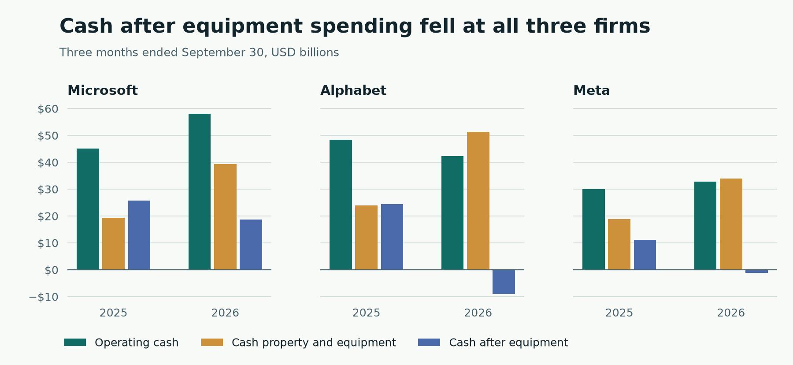

*Part of [The AI Infrastructure Reality Check](/ai-infrastructure-reality-check/).*

Across Microsoft, Alphabet and Meta, operating cash rose by $9.6 billion from the September 2025 quarter to the same quarter in 2026. Cash spent on property and equipment rose by $62.5 billion. I pulled the same cash-flow lines from the three companies' filings. The gap between those increases is where the story is. [Microsoft Form 10-Q](https://www.sec.gov/Archives/edgar/data/789019/000119312526436133/msft-20260930.htm) · [Alphabet results](https://www.sec.gov/Archives/edgar/data/1652044/000165204426000080/googexhibit991q32026.htm) · [Meta results](https://www.sec.gov/Archives/edgar/data/1326801/000162828026066700/meta-09302026xexhibit991.htm)

## The same subtraction across three statements

This comparison uses the three months through September 30 even though Microsoft calls the 2026 period its fiscal first quarter. Cash equipment spend means the purchases or additions to property and equipment shown in investing cash flow, stated here as a positive outflow. The residual is operating cash flow less that outflow. Every number is consolidated and includes the companies' other businesses.

| Company | Operating cash, 2025 → 2026 | Cash property and equipment, 2025 → 2026 | Cash after equipment, 2025 → 2026 |
| --- | ---: | ---: | ---: |
| Microsoft | $45.06bn → $58.00bn | $19.39bn → $39.37bn | $25.66bn → $18.63bn |
| Alphabet | $48.41bn → $42.29bn | $23.95bn → $51.36bn | $24.46bn → −$9.07bn |
| Meta | $30.00bn → $32.79bn | $18.83bn → $33.94bn | $11.17bn → −$1.16bn |
| **Three-company sum** | **$123.47bn → $133.08bn** | **$62.18bn → $124.66bn** | **$61.29bn → $8.41bn** |

The sum is a comparison of the three issuers' reported numbers. Their equipment purchases used 50.4% of the combined operating cash in the 2025 quarter and 93.7% a year later. Microsoft generated nearly $13 billion more operating cash and still had $7 billion less left after purchases. At Alphabet, weaker operating cash and larger equipment purchases pushed the residual below zero together. Alphabet's own trailing-twelve-month residual through September 2026 was still $19.7 billion, a useful check on what one quarter can tell you. [Alphabet's quarterly and trailing cash-flow reconciliation](https://www.sec.gov/Archives/edgar/data/1652044/000165204426000080/googexhibit991q32026.htm)

## The lease payment is on another line

Meta reports negative $2.12 billion of free cash flow for the 2026 quarter. This table gets negative $1.16 billion from the company's very same statements because Meta also subtracts $964 million of finance lease principal in its published measure. Under the table, subtracting reported financing cash paid on finance leases for all three firms takes the combined residual down from $8.41 billion to $5.34 billion. Alphabet separately discloses $159 million it paid in advance on leases expected to be finance leases. This narrower adjustment uses the separately reported financing cash for existing finance leases. [Meta reconciliation](https://www.sec.gov/Archives/edgar/data/1326801/000162828026066700/meta-09302026xexhibit991.htm) · [Alphabet lease note](https://www.sec.gov/Archives/edgar/data/1652044/000165204426000084/goog-20260930.htm) · [Microsoft lease note](https://www.sec.gov/Archives/edgar/data/789019/000119312526436133/msft-20260930.htm)

New lease obligations answer a different question. For the same quarter Microsoft reported $5.19 billion of finance-lease right-of-use assets obtained in exchange for lease obligations, and $1.00 billion of financing cash paid on finance leases. The former measures assets obtained through financing in the period. The latter measures cash paid on obligations across multiple lease cohorts. Putting both into a single cash outflow would mix the two clocks. [Microsoft Form 10-Q, Note 12](https://www.sec.gov/Archives/edgar/data/789019/000119312526436133/msft-20260930.htm)

A cash-flow statement tells me how much the rest of the business can fund in that period. The lease notes tell me some of the payments that will come due as capacity starts up. A line labeled "AI capex" would need a credible way to allocate shared infrastructure across AI and other workloads. These filings describe some of the drivers, including technical infrastructure at Alphabet, but the figures above are the consolidated totals. [Alphabet Form 10-Q](https://www.sec.gov/Archives/edgar/data/1652044/000165204426000084/goog-20260930.htm)

A quarterly cash squeeze and a sound investment can coexist. For the buildout to pay back, all those payments need to buy capacity that throws off cash after equipment and leases. The two September quarters show how much more cash the companies are committing ahead of that result.

[Download the filing values, formulas' outputs and source URLs as CSV.](/downloads/ai-infrastructure-reality-check/capex-cash-flow.csv)
