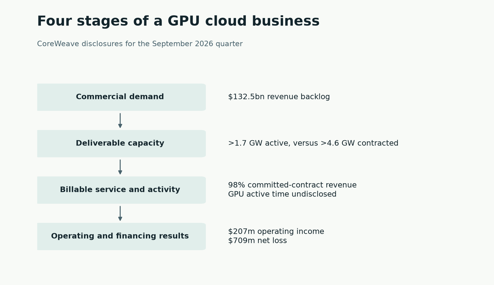

*Part of [The AI Infrastructure Reality Check](/ai-infrastructure-reality-check/).*

From the September 2025 quarter to the same quarter in 2026, Microsoft, Alphabet and Meta brought in $9.6 billion more operating cash. They spent $62.5 billion more on property and equipment. After those purchases, the three companies had $8.41 billion left between them, down from $61.29 billion a year earlier. [Microsoft Form 10-Q](https://www.sec.gov/Archives/edgar/data/789019/000119312526436133/msft-20260930.htm) · [Alphabet results](https://www.sec.gov/Archives/edgar/data/1652044/000165204426000080/googexhibit991q32026.htm) · [Meta results](https://www.sec.gov/Archives/edgar/data/1326801/000162828026066700/meta-09302026xexhibit991.htm)

## The same subtraction across three statements

Each column compares the three months through September 30. Microsoft calls the 2026 period its fiscal first quarter. I take cash purchases or additions to property and equipment from the investing section, show the spend as a positive amount, and subtract it from operating cash flow. The filings report consolidated figures for all of each company's businesses.

| Company | Operating cash, 2025 → 2026 | Cash property and equipment, 2025 → 2026 | Cash after equipment, 2025 → 2026 |
| --- | ---: | ---: | ---: |
| Microsoft | $45.06bn → $58.00bn | $19.39bn → $39.37bn | $25.66bn → $18.63bn |
| Alphabet | $48.41bn → $42.29bn | $23.95bn → $51.36bn | $24.46bn → −$9.07bn |
| Meta | $30.00bn → $32.79bn | $18.83bn → $33.94bn | $11.17bn → −$1.16bn |
| **Three-company sum** | **$123.47bn → $133.08bn** | **$62.18bn → $124.66bn** | **$61.29bn → $8.41bn** |

Equipment purchases absorbed 50.4% of the three companies' operating cash in the September 2025 quarter and 93.7% a year later. Microsoft brought in nearly $13 billion more operating cash and finished with about $7 billion less after purchases. Alphabet spent more on equipment as its operating cash fell, taking its quarterly balance below zero. Over the twelve months through September 2026, Alphabet still had $19.7 billion left after those purchases. [Alphabet's quarterly and trailing cash-flow reconciliation](https://www.sec.gov/Archives/edgar/data/1652044/000165204426000080/googexhibit991q32026.htm)

## The lease payment is on another line

Meta reported negative $2.12 billion of free cash flow for the 2026 quarter. Subtract its $964 million finance lease principal payment from the negative $1.16 billion in the equipment-only table and you get Meta's figure. Make the same principal-payment adjustment for all three firms and their combined balance drops from $8.41 billion to $5.34 billion. Alphabet also paid $159 million in advance on leases it expects to classify as finance leases. The $5.34 billion applies the narrower adjustment for separately reported financing cash paid on existing leases. [Meta reconciliation](https://www.sec.gov/Archives/edgar/data/1326801/000162828026066700/meta-09302026xexhibit991.htm) · [Alphabet lease note](https://www.sec.gov/Archives/edgar/data/1652044/000165204426000084/goog-20260930.htm) · [Microsoft lease note](https://www.sec.gov/Archives/edgar/data/789019/000119312526436133/msft-20260930.htm)

Look at Microsoft's lease note for the timing difference. It acquired $5.19 billion of finance-lease right-of-use assets by taking on lease obligations in the quarter. It also paid $1.00 billion in financing cash on leases. The first number measures the assets it obtained through financing that quarter. The second records cash payments on leases signed at different times. [Microsoft Form 10-Q, Note 12](https://www.sec.gov/Archives/edgar/data/789019/000119312526436133/msft-20260930.htm)

The cash flow and lease notes together show how much the business funds now and some of what comes due later. Estimating how much of that spending went to AI would require a way to split shared equipment and space across workloads. Alphabet identifies technical infrastructure as a driver. The table uses each company's consolidated totals. [Alphabet Form 10-Q](https://www.sec.gov/Archives/edgar/data/1652044/000165204426000084/goog-20260930.htm)

[Download the filing figures, calculations and source links as a CSV.](/downloads/ai-infrastructure-reality-check/capex-cash-flow.csv)

## How a supplier can also finance a customer

AMD and Anthropic put a $5 billion ceiling on stock purchases tied to hardware delivery and deployment milestones. The IPO prospectus also lists $2.5 billion of AMD equity in the private placement that Anthropic confirmed closed on November 20. Each dollar from that purchase counts toward the $5 billion cap. Adding the announcements would give $7.5 billion on paper. The agreement leaves room for another $2.5 billion as GPU deployment hits the remaining milestones. [Anthropic final prospectus, "AMD Agreement"](https://www.sec.gov/Archives/edgar/data/2130357/000162828026074944/anthropicpbc-424b4.htm) · [Anthropic closing announcement](https://www.anthropic.com/news/ipo-close)

AMD also helps supply the compute. Anthropic agreed to obtain an initial group of AMD-based racks subject to deployment conditions, potentially through approved system manufacturers or third-party providers. If Anthropic obtains the full initial capacity, it estimates spending more than $20 billion. The hardware framework leaves the dollar commitment open. That estimate tracks what Anthropic might spend on compute. The stock agreements track who supplies capital. [Anthropic final prospectus, "Contractual Obligations"](https://www.sec.gov/Archives/edgar/data/2130357/000162828026074944/anthropicpbc-424b4.htm)

Follow the arrows by what changes hands. A hardware supplier bills the buyer when the terms call for payment. An investor pays for a stake. With a reservation, the operator has a claim on future cash if it satisfies the contract.

| Relationship | Direction of value | Disclosure |
| --- | --- | --- |
| AMD equity | AMD → Anthropic, equity cash when issued | Up to $5bn, inclusive of the $2.5bn private placement purchase |
| AMD-based compute | Approved system supplier or service provider → Anthropic, hardware or access | Initial deployment subject to terms, with hardware or service spending following the applicable contract |
| NVIDIA hardware | NVIDIA → CoreWeave, GPUs | CoreWeave identifies NVIDIA as a GPU supplier |
| NVIDIA equity | NVIDIA → CoreWeave, equity cash | CoreWeave disclosed closing a $2bn investment in January 2026 |
| NVIDIA reservation | NVIDIA → CoreWeave, contingent service payments | A September 2025 order form has a $6.3bn initial value and covers residual unsold capacity through April 13, 2032, subject to service availability, delivery and contract terms |

[Anthropic prospectus](https://www.sec.gov/Archives/edgar/data/2130357/000162828026074944/anthropicpbc-424b4.htm) · [CoreWeave September 2025 Form 8-K](https://www.sec.gov/Archives/edgar/data/1769628/000176962825000047/crwv-20250909.htm) · [CoreWeave January 2026 Form 8-K](https://www.sec.gov/Archives/edgar/data/1769628/000176962826000044/crwv-20260123.htm)

CoreWeave has to deliver eligible capacity. If its other customers leave any of that capacity unsold, NVIDIA must buy the remainder under the terms of the order. That gives CoreWeave a buyer for eligible slots that would otherwise go empty, and it gives NVIDIA access to compute. The terms show who bears that risk. What NVIDIA runs, what it winds up paying and how much independent customers spend remain open questions. [CoreWeave September 2025 Form 8-K](https://www.sec.gov/Archives/edgar/data/1769628/000176962825000047/crwv-20250909.htm)

The ECB's November Financial Stability Review describes what happens if demand slows. Customer commitments and the credit or equity value of the firms that financed them can both weaken. A strong end market can still make it a sound deal. For a credit analysis, count actual customer invoices separately from equity funding and contingent reservations, especially when the same company supplies more than one. [ECB Financial Stability Review, November 2026](https://www.ecb.europa.eu/press/financial-stability-publications/fsr/focus/2026/html/ecb.fsrbox202611_03~4fd1449eaa.en.html)

## Follow commitments through to profit

At the end of September 2026, CoreWeave reported $132.5 billion of revenue backlog. For the quarter it reported $3.66 billion of revenue, $207 million of operating income and a $709 million net loss. Between the backlog and the income statement sit the machines it can deliver, the hours it can bill and its financing costs. [CoreWeave Q3 2026 results](https://www.sec.gov/Archives/edgar/data/1769628/000176962826000461/coreweave3q26earningspress.htm)

| Stage | Count or calculate | CoreWeave disclosure or data needed |
| --- | --- | --- |
| Commercial demand | Committed future service by delivery or start date | $132.5bn backlog at quarter end, including $132.3bn of remaining performance obligations |
| Deliverable capacity | Ready-to-serve GPU-hours, by region and machine type | Over 1.7 GW active power and over 4.6 GW contracted power. Host inventory and readiness telemetry are needed to compute GPU-hours |
| Billable service and actual usage | Paid reserved hours, metered on-demand hours and GPU active time as separate measures | Committed contracts accounted for 98% of quarterly revenue. Measuring actual GPU activity requires telemetry |
| Operating and financing results | Realized revenue, operating costs including depreciation, and financing costs | $3.66bn revenue, $207m operating income, $846m net interest expense and $709m net loss |

[CoreWeave Q3 2026 results](https://www.sec.gov/Archives/edgar/data/1769628/000176962826000461/coreweave3q26earningspress.htm) · [CoreWeave Form 10-Q, revenue recognition and risk factors](https://www.sec.gov/Archives/edgar/data/1769628/000176962826000465/crwv-20260930.htm)

CoreWeave's $132.3 billion of remaining performance obligations counts billed and unbilled commitments after estimated reductions. It expects to recognize 36% in the next 24 months and another 38% in months 25 through 48 as it delivers and makes services available. Dividing a quarter of revenue by that balance throws away the delivery schedule. [CoreWeave Form 10-Q, Note 2](https://www.sec.gov/Archives/edgar/data/1769628/000176962826000465/crwv-20260930.htm)

A power contract describes capacity the operator expects to have. Before a GPU can take a job, it needs an installation, commissioning and customer access. To count capacity in GPU-hours, use the inventory of working devices and the hours each one can serve the workload in question.

Track paid reservations, metered hours and active GPU time separately. A customer can leave a prepaid GPU idle and still pay for the hour. At renewal, that unused capacity gives the customer a reason to reconsider the contract.

CoreWeave reported a 62% adjusted EBITDA margin for the quarter. The largest adjustments in its reconciliation were $1.89 billion of depreciation and amortization and $846 million of net interest. Start with the $207 million of operating income, subtract the $846 million in interest, add $13 million in other income and deduct $83 million for taxes. That's how a profitable operating quarter becomes a $709 million net loss. [CoreWeave Q3 2026 results and non-GAAP reconciliation](https://www.sec.gov/Archives/edgar/data/1769628/000176962826000461/coreweave3q26earningspress.htm)
