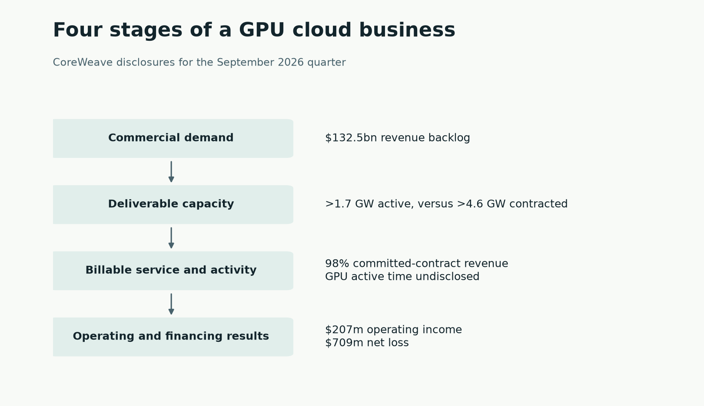

*Part of [The AI Infrastructure Reality Check](/ai-infrastructure-reality-check/).*

CoreWeave ended September 2026 with $132.5 billion of reported revenue backlog. It earned $3.66 billion of revenue during the quarter, booked $207 million of operating income and recorded a $709 million net loss. All four figures describe the same company. Each belongs on a different line of an operating review. [CoreWeave Q3 2026 results](https://www.sec.gov/Archives/edgar/data/1769628/000176962826000461/coreweave3q26earningspress.htm)

The missing figure is a GPU occupancy rate. What would we even mean by one? A scheduler counts reserved devices and completed jobs. The electricity meter sees power. Finance sees a contract and a clock. A customer buying guaranteed access may pay for all Monday while running work only after lunch.

## The four-stage funnel

| Stage | Count or calculate | CoreWeave disclosure or data needed |
| --- | --- | --- |
| Commercial demand | Committed future service by delivery or start date | $132.5bn backlog at quarter end, including $132.3bn of remaining performance obligations |
| Deliverable capacity | Ready-to-serve GPU-hours, by region and machine type | Over 1.7 GW active power and over 4.6 GW contracted power. Host inventory and readiness telemetry are needed to compute GPU-hours |
| Billable service and actual usage | Paid reserved hours, metered on-demand hours and GPU active time as separate measures | Committed contracts accounted for 98% of quarterly revenue. Measuring actual GPU activity requires telemetry |
| Operating and financing results | Realized revenue, operating costs including depreciation, and financing costs | $3.66bn revenue, $207m operating income, $846m net interest expense and $709m net loss |

[CoreWeave Q3 2026 results](https://www.sec.gov/Archives/edgar/data/1769628/000176962826000461/coreweave3q26earningspress.htm) · [CoreWeave Form 10-Q, revenue recognition and risk factors](https://www.sec.gov/Archives/edgar/data/1769628/000176962826000465/crwv-20260930.htm)

Backlog is a stock of potential future revenue, with delivery and service-availability conditions. The $132.3 billion of remaining performance obligations includes billed and unbilled committed consideration after estimated reductions. CoreWeave expected to recognize 36% over the next 24 months and another 38% in months 25 through 48. The quarter's revenue is a flow. Dividing the quarter's revenue by backlog gives a number with mismatched periods and leaves out future delivery dates. [CoreWeave Form 10-Q, Note 2](https://www.sec.gov/Archives/edgar/data/1769628/000176962826000465/crwv-20260930.htm)

Contracted power and active power have their own lag. Getting a power contract tells you something about the footprint a company plans to build. Capacity becomes schedulable after the equipment has been installed, commissioned and made available. A count of GPU-hours needs the devices and the hours for which they could actually serve that class of workload.

## Give the denominator a name

Imagine 100 commissioned GPUs across 24 hours, for 2,400 available GPU-hours. A customer reserved 70 GPUs for the day and ran kernels at an average of 30 GPU-equivalents over the 24 hours. Another 10 GPUs ran metered jobs for 12 hours. For this example, assume reservations were all billable and active hours include running those jobs for the full metered time.

| Metric | Calculation | Result |
| --- | --- | ---: |
| Billable fraction | (70 × 24 reserved + 10 × 12 metered) ÷ 2,400 | 75% |
| Active fraction | (30 × 24 active + 10 × 12 active) ÷ 2,400 | 35% |

Both rates can go on the same dashboard. If billable capacity stays at 75% while the active fraction falls, revenue may hold during the contract. The customer has a decision when it renews. If both are high but the realized price per hour has fallen below the full cost of serving it, the cluster has a different problem again.

The final rows of CoreWeave's quarter make the financing step concrete. Start with $207 million of operating income, subtract $846 million of net interest expense, add $13 million of other income and deduct $83 million of tax provision. That gives the reported $709 million net loss. The company's adjusted EBITDA margin was 62% over the same period. The largest adjustments in the published reconciliation were $1.89 billion of depreciation and amortization and $846 million of net interest. [CoreWeave Q3 2026 results and non-GAAP reconciliation](https://www.sec.gov/Archives/edgar/data/1769628/000176962826000461/coreweave3q26earningspress.htm)

A capacity review should show planned value by delivery cohort, commissioned hours by SKU and region, paid hours and active hours on separate time series, and realized revenue less economic cost by cohort. The separation matters most when one of those charts clears its target and the next one fails.
