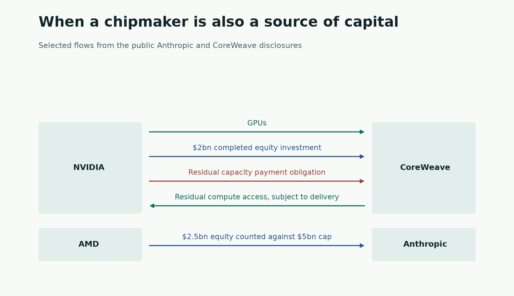

*Part of [The AI Infrastructure Reality Check](/ai-infrastructure-reality-check/).*

Anthropic's IPO prospectus contains a small piece of arithmetic that prevents a $2.5 billion mistake. AMD had agreed to buy up to $5 billion of Anthropic stock under its hardware supply framework, in increments tied to GPU delivery and deployment milestones. The prospectus also lists a $2.5 billion AMD equity purchase in the private placement alongside the IPO. Anthropic confirmed the private placement closed on November 20. The terms apply AMD's purchase against the original limit dollar for dollar. The remaining ceiling is $2.5 billion, with further draws subject to deployment milestones. Adding the two headline amounts would give $7.5 billion for an arrangement capped at $5 billion. [Anthropic final prospectus, "AMD Agreement"](https://www.sec.gov/Archives/edgar/data/2130357/000162828026074944/anthropicpbc-424b4.htm) · [Anthropic closing announcement](https://www.anthropic.com/news/ipo-close)

This detail matters because AMD also helps supply the compute. Anthropic agreed to obtain an initial tranche of AMD-based rack-scale capacity subject to deployment conditions, with access through approved system manufacturers or third-party providers among the possible routes. The prospectus gives a spending estimate in excess of $20 billion if the initial capacity is fully procured. The hardware framework specifies no fixed dollar commitment. The stock and the hardware therefore belong on different lines, and the hardware estimate has its own conditions. [Anthropic final prospectus, "Contractual Obligations"](https://www.sec.gov/Archives/edgar/data/2130357/000162828026074944/anthropicpbc-424b4.htm)

## A transaction graph you can audit

The arrows describe direction and purpose. A hardware shipment and payment for it would move in opposite directions. Equity financing puts money into an operator or lab in exchange for a stake. A reservation is a commitment whose future cash depends on the contract.

| Relationship | Direction of value | Disclosure |
| --- | --- | --- |
| AMD equity | AMD → Anthropic, equity cash when issued | Up to $5bn, inclusive of the $2.5bn private placement purchase |
| AMD-based compute | Approved system supplier or service provider → Anthropic, hardware or access | Initial deployment subject to terms, with hardware or service spending following the applicable contract |
| NVIDIA hardware | NVIDIA → CoreWeave, GPUs | CoreWeave identifies NVIDIA as a GPU supplier |
| NVIDIA equity | NVIDIA → CoreWeave, equity cash | CoreWeave disclosed closing a $2bn investment in January 2026 |
| NVIDIA reservation | NVIDIA → CoreWeave, contingent service payments | A September 2025 order form has a $6.3bn initial value and covers residual unsold capacity through April 13, 2032, subject to service availability, delivery and contract terms |

[Anthropic prospectus](https://www.sec.gov/Archives/edgar/data/2130357/000162828026074944/anthropicpbc-424b4.htm) · [CoreWeave September 2025 Form 8-K](https://www.sec.gov/Archives/edgar/data/1769628/000176962825000047/crwv-20250909.htm) · [CoreWeave January 2026 Form 8-K](https://www.sec.gov/Archives/edgar/data/1769628/000176962826000044/crwv-20260123.htm)

The NVIDIA reservation changes who bears the risk of an empty rack. CoreWeave still has to deliver eligible capacity. If CoreWeave's other customers leave that capacity unsold, NVIDIA is obliged to buy the residual under the disclosed terms. The commitment gives CoreWeave a buyer in that state and gives NVIDIA access to compute. Public terms let us follow the obligation. They give only a limited view of what NVIDIA runs on that capacity, what it ultimately pays under this order, and how much independent customer spend the combined arrangement generates. [CoreWeave September 2025 Form 8-K](https://www.sec.gov/Archives/edgar/data/1769628/000176962825000047/crwv-20250909.htm)

## Sum at the boundary that answers your question

If the question is how much cash a cloud operator got, use the relevant cash receipts, separately from financing inflows. If the question is how many racks are financed, read the debt and equity agreements alongside the assets being installed. For end-customer demand, trace payments from outside the group of counterparties you are studying.

Take a toy example. A chip supplier invests $40 in a lab. The lab pays a cloud operator $100 for capacity, drawing on the investment, customer receipts and its opening cash. The operator pays the supplier $70 for equipment. A customer outside the group spends $30 on the lab's application. The three companies can each have a commercial transaction to report under their own accounting. On an end-customer cash measure defined at the edge of this group, $30 crossed the boundary. The $40 equity investment belongs in the financing ledger. The $100 and $70 are upstream commercial flows at successive stages.

The ECB's November Financial Stability Review points to a specific risk from these links. A slowdown can affect both the customer commitments and the credit or equity value of counterparties that helped finance those commitments. A strong end market can still make the arrangement worthwhile. Counting an equity cheque, a contingent backup contract and an end-customer invoice as three independent demand signals is how the credit analysis goes wrong. [ECB Financial Stability Review, November 2026](https://www.ecb.europa.eu/press/financial-stability-publications/fsr/focus/2026/html/ecb.fsrbox202611_03~4fd1449eaa.en.html)
