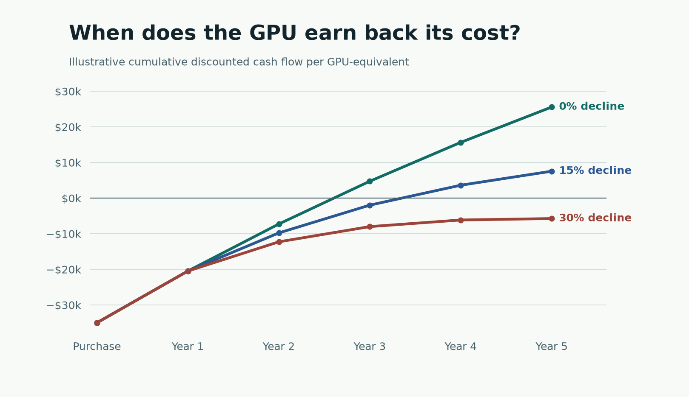

*Part of [The AI Infrastructure Reality Check](/ai-infrastructure-reality-check/).*

In the model below, a GPU earns $2 an hour for 90% of the year and still finishes $1,212 short. The operator bought a share of the server and network along with the GPU and needs to recover that investment over four years. At $2.50 an hour, the same installation breaks even at about 77% billable time. The [GPU break-even calculator](/downloads/ai-infrastructure-reality-check/gpu-break-even.html) lets you price your own assumptions.

## Price the billable hour

Suppose a customer reserves eight GPUs and runs jobs on six. The invoice covers eight. The provider could keep all eight busy for a week testing its own software and bill nothing for that time. Start with the 8,760 calendar hours each GPU provides per year. Count the hours customers actually pay for, leaving outages, maintenance and idle periods in the denominator.

Each GPU has to pay for part of the host and network fabric as well as the accelerator itself. The capital charge converts that bill into a yearly cost at the return the operator requires. Fixed operations and idle electricity also accrue all year. The rest of the electricity bill follows the hours the equipment spends under load.

```text
capital charge = installed cost × r / (1 − (1 + r)^(−life))
baseline power cost = idle IT kW × PUE × $/kWh × calendar hours
variable cost per billable hour = (load IT kW − idle IT kW) × PUE × $/kWh
annual fixed cost = capital charge + fixed operations + baseline power cost

break-even rate = annual fixed cost / (8,760 × billable fraction)
                  + variable cost per billable hour
break-even billable fraction = annual fixed cost
                               / (8,760 × (realized rate − variable cost))
```

Here `r` is the annual cost of capital. With a zero discount rate, divide the installed cost by the years of service. The example assigns zero resale value. Fixed operations cover each GPU's share of staffing, maintenance, floor space and recurring network costs. Include power demand charges and fees for reserved utility capacity in fixed operations if the site pays them. Power usage effectiveness (PUE) is total facility electricity divided by IT electricity for the same period. Multiplying IT consumption by PUE adds the facility's share of cooling and other overhead.

| Base case assumption | Amount per GPU |
| --- | ---: |
| Installed cost, including allocated host and fabric | $36,000 |
| Economic life and annual cost of capital | 4 years, 10% |
| Annual fixed operations | $4,800 |
| Allocated idle / loaded IT draw | 0.25 / 0.90 kW |
| PUE and energy tariff | 1.25, $0.09/kWh |
| Realized rate and billable fraction | $2.00/h, 90% |

NVIDIA specifies up to 700 W of configurable thermal design power (TDP) for the H100 SXM. The loaded draw in the model, 0.90 kW, is an assumption for the GPU and its share of the other IT equipment. The equation applies loaded power to billable hours and idle power to the rest. If the provider runs internal jobs, add their electricity separately. [NVIDIA H100 specifications](https://www.nvidia.com/en-us/data-center/h100/)

Recovering the $36,000 investment at the required return costs about $11,357 a year. Add operations and idle electricity and the annual fixed bill comes to $16,403, even with an empty booking calendar. Each loaded hour adds about 7.3 cents. At 90% billable, the provider earns $15,768 over 7,884 hours and incurs about $16,980 in annual costs including the capital charge. That's the economic result before tax. The cash account follows the actual payment dates.

| Realized rate | Share of calendar hours needed |
| ---: | ---: |
| $1.50 | 131.2%, infeasible |
| $2.00 | 97.2% |
| $2.50 | 77.2% |
| $3.00 | 64.0% |
| $4.00 | 47.7% |



Cut the electricity tariff from 9 to 7 cents per kWh and the provider saves about $183 a year at 90% billable. Losing ten points of billable time, from 90% to 80%, costs about $1,688 a year at $2/h even after the electricity savings. At this site and with this equipment, finding paying workloads does more for the budget than negotiating those two cents.

## Put a price on years four and five

A functioning server can have years of work left when demand for its GPU generation falls. A depreciation schedule gives another answer to how long the equipment will last. CoreWeave's 2025 annual report lists six years for technology equipment. In January 2025 Meta extended the estimated useful life of most servers and network assets to 5.5 years. These policies apply to asset classes that include several GPU generations and, at Meta, network equipment. [CoreWeave 2025 Form 10-K](https://www.sec.gov/Archives/edgar/data/1769628/000176962826000104/crwv-20251231.htm) · [Meta 2025 Form 10-K](https://www.sec.gov/Archives/edgar/data/1326801/000162828026003942/meta-20251231.htm)

The first model charges for four years of equipment and assumes a steady rental rate. Suppose customers start paying less after a new GPU generation ships. The buyer needs to know how much years four and five are worth at the price customers would actually pay.

In this second scenario, one GPU's share of the installation costs $35,000. It earns $3.20 per billable GPU-hour in year one. At 72% of 8,760 calendar hours, it sells 6,307.2 hours each year. Power, hosting, maintenance and labor cost $4,200 in cash each year. All inputs are assumptions. The model discounts year-end cash flows at 10%, assumes zero salvage value, and excludes taxes, working-capital changes and financing cash flows. Subtracting the investment from the discounted cash gives net present value (NPV).

```text
rate in year t = $3.20 × (1 − annual rate decline)^(t − 1)
year t cash = 6,307.2 × rate in year t − $4,200
NPV through year T = −$35,000 + sum of year t cash / 1.10^t
```

| Annual decline in realized rate | Year 5 cash | 3-year NPV | 5-year NPV |
| --- | ---: | ---: | ---: |
| 0% | $15,983 | +$4,747 | +$25,588 |
| 15% | $6,336 | −$1,963 | +$7,569 |
| 30% | $646 | −$7,990 | −$5,729 |



Every row starts with the same year-one cash flow. With an annual price drop of 15%, years four and five take net present value above zero. With a 30% annual drop, the machine still generates $646 of cash in year five. The project has a $5,729 shortfall in present-value terms. At that rate of decline, the operator needs about $3.61 per billable hour in year one to make a five-year project break even.

Every scenario sells the same number of hours. A departing customer could cut both occupancy and the achievable price. The reverse can happen when a lower rate brings in work for otherwise idle GPUs. You can set the billable share and price decline in the model to see how much each assumption costs. [Run the Python model](/downloads/ai-infrastructure-reality-check/gpu-economic-life.py) · [Download the default results](/downloads/ai-infrastructure-reality-check/gpu-economic-life.csv)

## Convert rack-hours to useful tokens

In the published DeepSeek-R1 runs, one GB200 rack produced 523,790 output tokens per second in Offline and 240,274 in Interactive. If the hourly rack cost stays fixed, the cost of producing a million output tokens at the interactive throughput is 2.18 times the offline cost. Quiet periods, retries and spare capacity for traffic spikes would raise the cost further. [MLPerf Inference v6.1, NVIDIA DeepSeek-R1 submission](https://github.com/mlcommons/inference_results_v6.1/tree/6623c6c8bac460c46a8768ac261bc0889c9c7f13/closed/NVIDIA/results/GB200-NVL72_GB200-186GB_aarch64x72_TRT/deepseek-r1)

MLCommons marks all three runs as valid. They come from one submitter using the same system and model. Offline measures bulk processing. Server and Interactive send requests online and impose latency limits, with a tighter time-per-output-token limit for Interactive. The submissions can use different serving settings, so the numbers describe each run's complete configuration.

| Scenario | Output tokens/s, rack-wide | p99 time to first token | p99 time per output token |
|---|---:|---:|---:|
| [Offline](https://github.com/mlcommons/inference_results_v6.1/blob/6623c6c8bac460c46a8768ac261bc0889c9c7f13/closed/NVIDIA/results/GB200-NVL72_GB200-186GB_aarch64x72_TRT/deepseek-r1/Offline/performance/run_1/mlperf_log_summary.txt) | 523,790 | N/A | N/A |
| [Server](https://github.com/mlcommons/inference_results_v6.1/blob/6623c6c8bac460c46a8768ac261bc0889c9c7f13/closed/NVIDIA/results/GB200-NVL72_GB200-186GB_aarch64x72_TRT/deepseek-r1/Server/performance/run_1/mlperf_log_summary.txt) | 395,940 | 869 ms | 65.8 ms |
| [Interactive](https://github.com/mlcommons/inference_results_v6.1/blob/6623c6c8bac460c46a8768ac261bc0889c9c7f13/closed/NVIDIA/results/GB200-NVL72_GB200-186GB_aarch64x72_TRT/deepseek-r1/Interactive/performance/run_1/mlperf_log_summary.txt) | 240,274 | 527 ms | 14.6 ms |

{{< figure class="series-figure" src="/downloads/ai-infrastructure-reality-check/mlperf-throughput-and-token-cost.webp" link="/downloads/ai-infrastructure-reality-check/mlperf-throughput-and-token-cost.webp" alt="Offline, Server and Interactive measured 524k, 396k and 240k tokens per second. Their modeled costs per million were $0.115, $0.152 and $0.250." caption="Throughput comes from the published MLPerf runs. The costs assume $216 per rack-hour, full benchmark throughput and 100% usable output." width="1184" height="696" >}}

A rack can generate hundreds of thousands of tokens per second because it serves requests in parallel. At the other end of one request, a user waits for the first token and then reads the rest as they arrive. The published interactive run gives that user a faster stream while the rack generates fewer tokens overall.

The server reads the prompt during prefill and saves the attention keys and values in a KV cache. Decode uses that cache to produce each successive output token. Continuous batching lets the GPU do work for several requests in one step. A long prefill can delay requests already decoding, and larger batches can also affect their latency. The DistServe researchers measured the interference and separated prefill and decode onto different GPU pools. That puts the KV cache on the network between the pools, so the link now has to carry it. [DistServe, OSDI 2024](https://www.usenix.org/conference/osdi24/presentation/zhong-yinmin)

Price the 72 GPUs at an assumed $3 each and the pool costs $216 for every hour you provision it. For rented GPUs, start with the invoice and add services billed separately. For an owned rack, allocate equipment, facilities, power, networking and operations by the hour. Divide that hourly cost by the usable output from the same hour.

```text
USD per million usable output tokens =
    hourly pool cost * 1,000,000
    / (3,600 * reference output tokens/second * realized throughput share * usable-token share)
```

At full benchmark throughput and 100% usable output, the cost per million is $0.115 for Offline, $0.152 for Server and $0.250 for Interactive. Now suppose the provisioned rack averages 55% of that Interactive throughput and 90% of the output tokens come from requests that met the service target. The result is **$0.504 per million usable output tokens**. The 55% measures throughput across the hour. GPU activity would measure something else. The 90% counts tokens in qualifying requests, so a long request carries more weight than a short one.

The benchmark's workload already incorporates the cost of processing its prompts. These calculations exclude API prices. A live workload can have longer prompts, different prefix reuse, extra reasoning output or more cancellations. Charge retries to the pool and count accepted output once.

Run `python3 physical-infrastructure-models.py tokens` to reproduce the calculation. The `--hourly-cost`, `--fill` and `--usable` options let you substitute your own inputs. For a deployment decision, replay real prompts and output lengths against the latency target. Divide the pool's cost by the output from requests that met the target. [Download the model](/downloads/ai-infrastructure-reality-check/physical-infrastructure-models.py)
