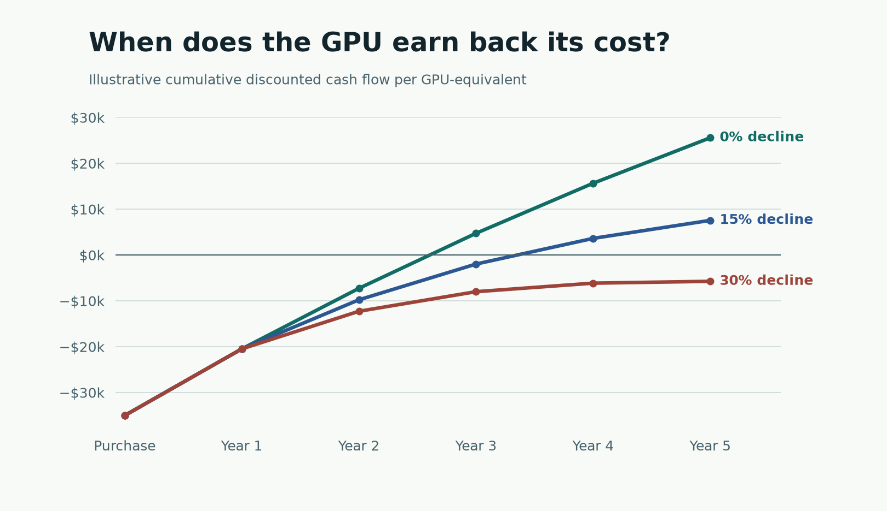

*Part of [The AI Infrastructure Reality Check](/ai-infrastructure-reality-check/).*

Google Cloud still lists A100 virtual machines for fine-tuning and inference. Meanwhile, the ECB's November 2026 Financial Stability Review marks one to three years as an estimate of the economic life of AI equipment, citing market intelligence. A product listing and an industry risk estimate tell you very different things about what an older rack can earn at a given site. [Google Cloud machine types](https://docs.cloud.google.com/compute/docs/gpus/) · [ECB review, Chart B](https://www.ecb.europa.eu/press/financial-stability-publications/fsr/focus/2026/html/ecb.fsrbox202611_03~4fd1449eaa.en.html)

A three-year rental model can underestimate the value of a machine with a good second job. A five-year model can overestimate it if years four and five depend on keeping the same hourly rate.

## Three dates for the same machine

The physical life ends when the machine stops being serviceable. The accounting life is the period over which management expects to depreciate the asset, subject to its accounting policies and estimates. CoreWeave's 2025 annual report lists six years for technology equipment. Meta extended the estimated useful life of most servers and network assets to 5.5 years in January 2025. Those are policies for asset classes that include more than one GPU generation and, in Meta's case, network equipment. [CoreWeave 2025 Form 10-K](https://www.sec.gov/Archives/edgar/data/1769628/000176962826000104/crwv-20251231.htm) · [Meta 2025 Form 10-K](https://www.sec.gov/Archives/edgar/data/1326801/000162828026003942/meta-20251231.htm)

Economic life depends on what the operator can earn in the rack and what else the same power, space and support budget could do. A cluster aging out of a frontier training job can keep earning its keep on smaller models, model evaluation or workloads already tuned to the hardware. The operator still needs a customer willing to buy the resulting service at a price that covers the incremental cost and beats the alternatives.

And a machine can clear that test without paying back its purchase price. At the end of year three, selling a further hour above incremental cost can make sense even if the installation, considered from day zero, was a bad purchase.

## Put a price on years four and five

Consider an illustrative GPU-equivalent slice of a deployment. It costs $35,000 up front, including its share of server and network hardware. The year-one realized rate is $3.20 per billable GPU-hour. At 72% of 8,760 calendar hours, it bills 6,307.2 hours a year. Annual operating cash cost is $4,200, covering the modeled allocation of power, hosting, maintenance and labor. All rates and costs are assumed. The model discounts year-end cash flows at 10%, with zero salvage value and no taxes, working-capital changes or financing cash flows.

```text
rate in year t = $3.20 × (1 − annual rate decline)^(t − 1)
year t cash = 6,307.2 × rate in year t − $4,200
NPV through year T = −$35,000 + sum of year t cash / 1.10^t
```

| Annual decline in realized rate | Year 5 cash | 3-year NPV | 5-year NPV |
| --- | ---: | ---: | ---: |
| 0% | $15,983 | +$4,747 | +$25,588 |
| 15% | $6,336 | −$1,963 | +$7,569 |
| 30% | $646 | −$7,990 | −$5,729 |



Year one is identical across all three rows. At a 15% decline, years four and five rescue the economics. At a 30% decline, the GPU is still generating a little operating cash in year five and still falls $5,729 short in present-value terms. At that steeper decline, a five-year project needs a starting rate of about $3.61 per billable hour to break even under the same assumptions.

The model holds billable hours constant while the price falls. In practice, an older fleet can lose both at once if a customer leaves. Alternatively, a lower price can fill previously idle capacity. Neither relationship is estimated here. The table is a sensitivity test. [Run the Python model](/downloads/ai-infrastructure-reality-check/gpu-economic-life.py) · [Download the default results](/downloads/ai-infrastructure-reality-check/gpu-economic-life.csv)

## Which workload earns the next hour?

A replacement analysis starts with the intended workload. Benchmark each candidate on accepted work per kilowatt-hour. For inference, that could mean output tokens delivered within a specific latency target, with the same model, input length, output length and request mix. At a fixed utility connection, the difference in work per megawatt can make the faster machine attractive even at a higher hourly cost.

Then compare the present value of future cash if you keep the old fleet with the value from redeploying, selling or replacing it. Include the value of power and rack space each plan uses, the cost and downtime of the move, and the old machine's resale value if you can get it. The capital spend already incurred belongs in the original project postmortem. The next placement decision depends on the cash and constraints still in front of you.
