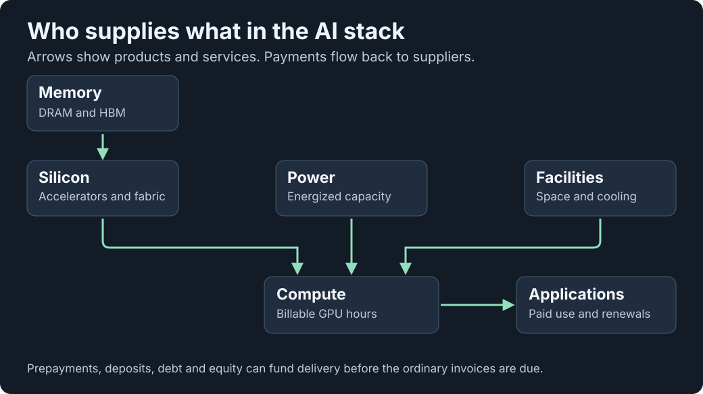

*Part of [The AI Infrastructure Reality Check](/ai-infrastructure-reality-check/).*

NVIDIA reported $107.6 billion in Data Center revenue for the quarter ended October 25, 2026. For the quarter ended September 30, CoreWeave reported $3.66 billion in revenue and a $709 million net loss. Those totals cover different periods and different businesses. The chip supplier gets paid for hardware. The cloud operator needs to rent out capacity long enough to cover what it cost to put into service. [NVIDIA Q3 FY2027 results](https://investor.nvidia.com/news/press-release-details/2026/NVIDIA-Announces-Financial-Results-for-Third-Quarter-Fiscal-2027/default.aspx) · [CoreWeave Q3 2026 results](https://www.sec.gov/Archives/edgar/data/1769628/000176962826000461/coreweave3q26earningspress.htm)

Start with the invoice. If racks sit idle, does the chip supplier already have its money? Is the cloud operator still paying the data-center lease? Did the customer reserve the capacity in advance? Calling the whole thing an AI bubble skips the terms that tell you who loses money when demand comes in short.

## Six invoices, six ways to get paid

| Business | Who pays for what | Where the risk sits |
| --- | --- | --- |
| Accelerator and network silicon | Cloud and system buyers pay for accelerators, switches and other equipment. | The supplier has to plan production before demand settles. The buyer takes on the useful life and resale risk after accepting the equipment. |
| Memory | Accelerator makers and system vendors pay for HBM or conventional DRAM. | Memory producers allocate wafer capacity and invest ahead of demand. Buyers may commit to supply before the downstream machine earns anything. |
| Data-center development | Tenants pay for commissioned capacity, space and connectivity. | The party funding construction carries the delivery risk. Lease commencement, guarantees and remedies determine who pays for the delay. |
| Power | Facilities or their suppliers pay for energy, capacity and grid or on-site infrastructure. | The contract and local tariff determine who carries demand shortfalls and who funds upgrades. A power reservation is one milestone on the way to energization. |
| Compute | Labs and enterprises pay for reserved capacity or metered usage. | The operator has equipment, financing and delivery exposure. A take-or-pay contract can transfer some occupancy risk to the customer once the service is available. |
| Applications and models | People and businesses pay for API usage, subscriptions or software that performs a task. | The seller has to retain customers and cover serving and development costs. Renewal is where the original usage claim meets a budget decision. |

One hyperscaler can fill several rows. Its cloud division can charge an internal transfer price, but that revenue drops out when the company consolidates its accounts. Between companies, both a GPU sale and a cloud booking count as transactions. Add those numbers together to track activity across suppliers. To measure final demand, count what customers pay for AI products.

## The strongest evidence of real demand

Anthropic's final prospectus shows what paid adoption looks like in one company's accounts. For the nine months ended September 30, 2026, it reported $33.242 billion in revenue, up from $2.545 billion in the same period a year earlier. Anthropic attributed $24.2 billion of that increase to consumption-based revenue and $6.5 billion to subscriptions. Most of the increase came from usage. [Anthropic final prospectus, MD&A](https://www.sec.gov/Archives/edgar/data/2130357/000162828026074944/anthropicpbc-424b4.htm)

By September 30, 2026, Anthropic counted more than 11,900 customers generating at least $100,000 each over the previous twelve months, up from more than 950 a year earlier. That group accounted for about 74% of revenue in the first nine months of 2026. Those thresholds use Anthropic's definition of a customer. A handful of customers within the group could still account for a large share of sales. [Anthropic final prospectus, revenue comparison](https://www.sec.gov/Archives/edgar/data/2130357/000162828026074944/anthropicpbc-424b4.htm)

The U.S. Census Bureau's Business Trends and Outlook Survey asked a nationally representative sample of firms whether they used AI in a business function. Researchers found that 18% did during the November 2025 to January 2026 reference period. Weight the firms by employment and the share rises to 32%, because larger businesses reported using AI more often. That 32% is the share of employees who work for firms that reported using AI. [U.S. Census Bureau working paper, The Microstructure of AI Diffusion](https://www.census.gov/library/working-papers/2026/adrm/CES-WP-26-25.html)



A company can report using AI in a workflow without knowing what the workflow saves. The survey measures how widely firms say they've put AI to work. The prospectus puts a dollar figure on one vendor's sales.

The International Energy Agency estimates that global electricity demand from data centers rose 17% in 2025. At sites the IEA classifies as AI-focused, it rose 50%. Electricity demand covers everything the facility powers, including the overhead for keeping equipment running. The meter gives a separate way to track the buildout. To measure the return, you need figures on the revenue those sites help earn and what it costs to run them. [IEA, Key Questions on Energy and AI](https://www.iea.org/reports/key-questions-on-energy-and-ai/executive-summary)

## Five tests to score by December 31, 2027

I expect paid use to grow even as some operators wait to commission new sites or struggle to earn back what they spent. These five thresholds date to November 20, 2026. Each one calls for a figure from a public disclosure.

The [scorecard CSV](/downloads/ai-infrastructure-reality-check/prediction-scorecard.csv) has a row for each threshold, with space to fill in results as the filings come out.

{{< figure class="series-figure" src="/downloads/ai-infrastructure-reality-check/ai-boom-prediction-scorecard.webp" link="/downloads/ai-infrastructure-reality-check/ai-boom-prediction-scorecard.webp" alt="Five thresholds for 2027 measure Anthropic compute expense as a share of revenue, CoreWeave power and interest coverage, Digital Realty lease lag, and NVIDIA Data Center revenue." caption="The 2026 disclosures establish the baselines. The deadline for scoring the five predictions is December 31, 2027." width="1184" height="760" >}}

### 1. A model company will turn usage growth into a lower compute ratio

For the nine months ending September 30, 2027, I expect Anthropic's compute and infrastructure operating expense to come in below 50% of revenue. Its final prospectus puts the figure at 56.6% for the same period in 2026, or $18.808 billion in expenses on $33.242 billion in revenue. The expense line covers research and development compute as well as production infrastructure. A drop below 50% would show sales growing faster than the combined bill. [Anthropic final prospectus, MD&A](https://www.sec.gov/Archives/edgar/data/2130357/000162828026074944/anthropicpbc-424b4.htm)

At 50% or above, I'd temper the claim that Anthropic is outrunning its compute costs. A lower ratio could also reflect a change in what customers buy, new contract terms or the timing of a bill. Scoring this test takes comparable nine-month totals on the same reporting basis, including any restatement. Estimating gross margin per million tokens would take data specific to inference.

### 2. CoreWeave will bring a larger fraction of its contracted power online

I expect CoreWeave's active power to reach at least 45% of its contracted power in Q3 2027. Its Q3 2026 figures give a rough starting point of 37%, based on over 1.7 GW active and over 4.6 GW contracted. [CoreWeave Q3 2026 results](https://www.sec.gov/Archives/edgar/data/1769628/000176962826000461/coreweave3q26earningspress.htm)

A surge in new power agreements could bring the ratio down even as more sites come online. Write down the active gigawatts alongside the ratio and check whether CoreWeave changed its definition. Power capacity speaks to site readiness. Customer usage comes from the work those sites actually run.

### 3. An operator's operating income will still trail its net interest bill

I expect CoreWeave's GAAP operating income to fall short of its net interest bill in Q3 2027. A year earlier, the company reported $207 million in operating income and $846 million in net interest expense. Compare the same quarterly income-statement lines when the 2027 figures arrive. The threshold uses the interest expense as a positive amount. [CoreWeave Q3 2026 results](https://www.sec.gov/Archives/edgar/data/1769628/000176962826000461/coreweave3q26earningspress.htm)

If operating income covers that interest bill, CoreWeave will have eased the financing squeeze sooner than I expect. GAAP operating income is the measure for this test. Principal repayments, capital expenditure and taxes remain separate cash commitments.

### 4. New leases will still carry a double-digit wait to commencement

I expect Digital Realty's weighted-average lag from signing a new lease to its contractual start date to come in at 12 months or longer in Q3 2027. The lag for leases signed in Q3 2026 was 17 months. [Digital Realty Q3 2026 results](https://www.sec.gov/Archives/edgar/data/1297996/000110465926120212/dlr-ex99d1.htm)

A shorter wait would weaken the case for long delays before rental revenue starts for that quarter's leases. Look for the share of large-capacity deals in the release. A run of small deals in ready-to-use buildings can pull the average down while large projects still wait for switchgear.

### 5. Chip sales will grow through the conversion delays

I expect NVIDIA's Data Center segment to report at least $120 billion in Q3 FY2028 revenue on a comparable basis. That's roughly 11.5% above the $107.6 billion it reported in Q3 FY2027. [NVIDIA Q3 FY2027 results](https://investor.nvidia.com/news/press-release-details/2026/NVIDIA-Announces-Financial-Results-for-Third-Quarter-Fiscal-2027/default.aspx)

If NVIDIA falls short, I'll revisit my expectation that chip sales can keep growing while operators struggle to turn installed capacity into profitable work. I'd check first for a product launch delay, a customer inventory drawdown or a change in segment reporting.

By December 31, 2027, score the original thresholds against the first comparable filings or earnings releases available by then. Mark a result **unscorable** if the company drops the disclosure, changes the definition or reports a rounded number that could fall on either side of the threshold.

CoreWeave appears twice, so those two outcomes may move together. If all five predictions land, the data will support a picture of growing sales with uneven returns across the businesses. If Anthropic's compute bill stays above half of revenue and CoreWeave covers its interest, I'll have to ask why the cloud operator got relief before one of its customers did.