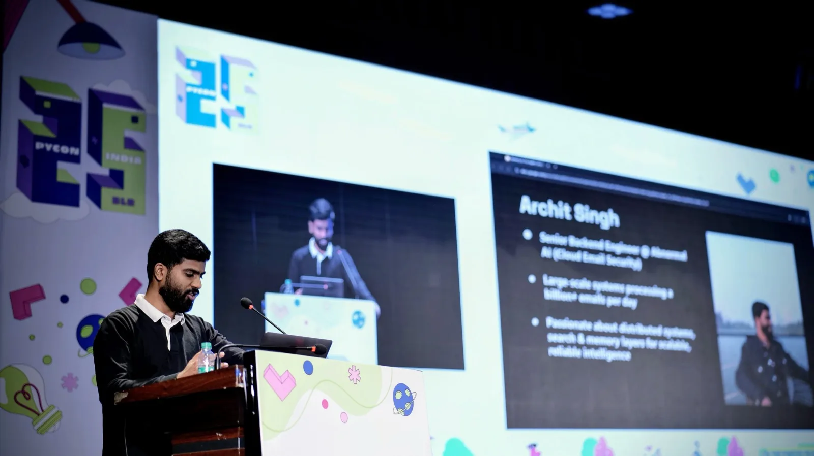
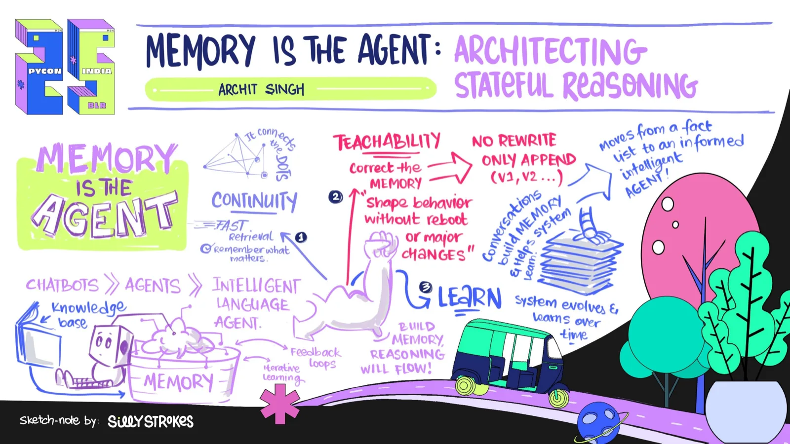

I speak about email security, AI agents, detection engineering, persistent memory and reliable execution. I use examples from my projects to explain the implementation choices and what happened when I tested them.

**[Invite me to speak](mailto:contact.architsingh@gmail.com?subject=Speaking%20invitation)** · [Watch my PyCon talk](#watch-the-talk)

## Proposed sessions

- **Memory is the Agent.** Capture, retrieval and continuity across sessions, grounded in Lorevell (formerly Memori). For engineers building stateful agents.
- **The model is not the agent.** Tools, permissions, recovery and observability in an agent harness. For teams moving beyond a prototype.
- **Evaluating agents through their interface.** What final messages miss, and how terminal captures and execution records answer different questions. For agent-tool builders and evaluators.

I can adapt the depth and format to your audience. Email me with the event date, audience and session length.

## Short bio

Archit Singh is a Senior Software Engineer at Abnormal AI, building AI agents and detection systems for email security. He works at the intersection of security, agent reliability and distributed systems. His independent public projects include Lorevell (formerly Memori), a local Markdown knowledge vault for humans and agents, and Luffy, an auditable PR review agent. He presented “Memory is the Agent: Architecting Stateful Reasoning” at PyCon India 2025 and writes about agent memory, deterministic constraints, evaluation and observability.

Organizer resources: [public speaker profile](https://cfp.in.pycon.org/2025/speaker/FE9SPU/) · [stage photograph](/images/uploads/pycon-2025-presenting.webp) · [projects](/projects/). Please confirm image reuse permissions before publication.

## PyCon India 2025

*On stage at PyCon India, 13 September 2025.*

**[Memory is the Agent: Architecting Stateful Reasoning](https://cfp.in.pycon.org/2025/talk/XN3P7N/)**  
13 September 2025, 11:30. [Speaker profile](https://cfp.in.pycon.org/2025/speaker/FE9SPU/).

The talk explores a write → retrieve → reflect → update loop for maintaining agent state, with a small schema for identity, principles, focus and signals. It introduced ideas I later developed in [Lorevell (formerly Memori)](/projects/#lorevell).

*Sketch-note companion to the talk, by Sway Strokes.*

## Watch the talk



[Watch on YouTube](https://www.youtube.com/watch?v=0pZB2Xg0gKo)

[Contact me about a talk or workshop](/contact/).
